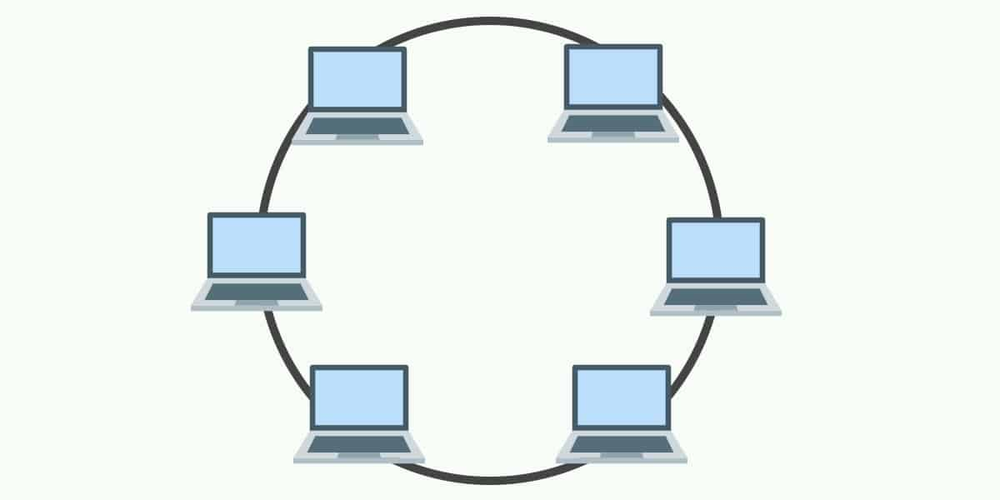
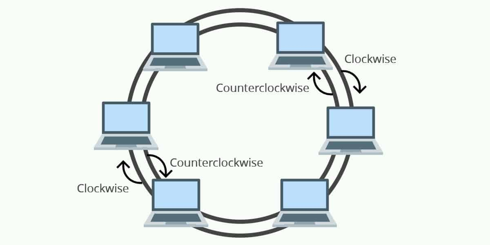
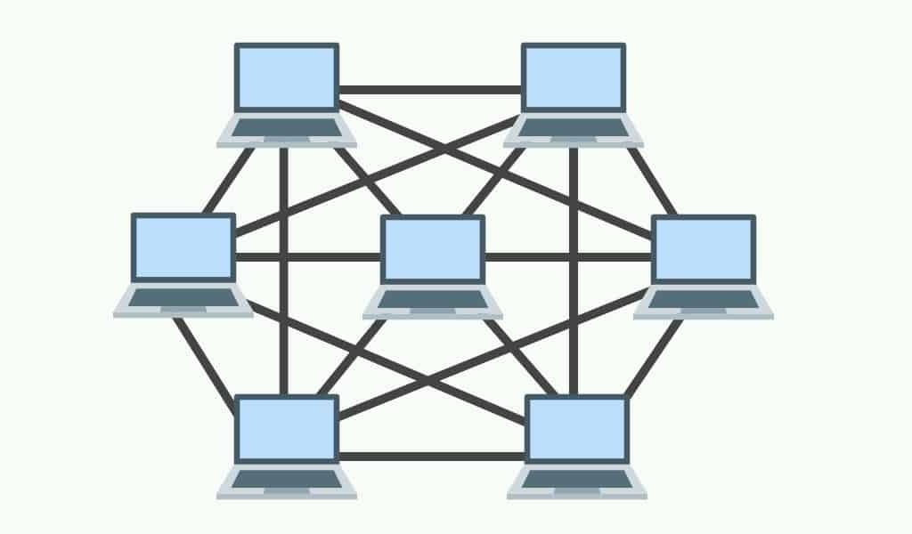
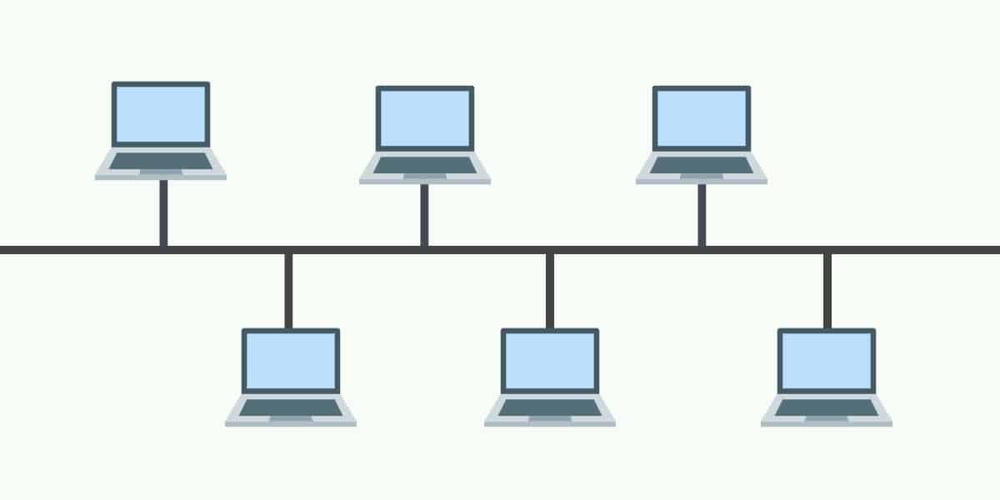

## 1. Pendahuluan

Dalam dunia teknologi informasi, jaringan komputer memiliki peran penting untuk menghubungkan perangkat agar dapat saling berkomunikasi dan bertukar data. Jaringan komputer digunakan dalam berbagai lingkungan, mulai dari rumah, sekolah, perkantoran, hingga perusahaan berskala besar.

Salah satu aspek penting dalam membangun jaringan komputer adalah menentukan topologi jaringan. Pemilihan topologi yang tepat dapat memengaruhi kecepatan pengiriman data, biaya pembangunan jaringan, serta kemudahan pemeliharaan dan pengembangan jaringan.

Pada artikel ini, kita akan membahas pengertian topologi jaringan komputer, klasifikasinya, jenis-jenis topologi yang umum digunakan, serta kelebihan dan kekurangan masing-masing jenis.

## 2. Pengertian Topologi Jaringan Komputer

Topologi jaringan komputer adalah metode atau pola yang digunakan untuk menghubungkan satu komputer dengan komputer lainnya sehingga membentuk suatu jaringan.

Setiap topologi mempunyai karakteristik yang berbeda, terutama dalam hal:

- Kecepatan pengiriman data.
- Biaya pembangunan jaringan.
- Kemudahan pemeliharaan dan perbaikan ketika terjadi gangguan.
- Kemudahan pengembangan jaringan ketika jumlah perangkat bertambah.

Tidak ada satu topologi yang selalu menjadi pilihan terbaik untuk semua kondisi. Pemilihannya harus disesuaikan dengan kebutuhan, jumlah perangkat, anggaran, dan skala jaringan yang akan dibangun.

## 3. Klasifikasi Topologi Jaringan

Berdasarkan materi perkuliahan, topologi jaringan dapat diklasifikasikan menjadi dua jenis utama.

### A. Physical Topology

*Physical topology* atau topologi fisik menggambarkan bagaimana perangkat jaringan, seperti komputer, switch, router, dan kabel, ditempatkan serta dihubungkan secara fisik.

Contohnya adalah topologi Star, ketika beberapa komputer terhubung ke satu perangkat pusat, seperti switch, melalui kabel jaringan.

Topologi fisik membantu administrator jaringan merencanakan tata letak perangkat, jalur kabel, dan kebutuhan infrastruktur jaringan.

### B. Logical Topology

*Logical topology* atau topologi logis menggambarkan bagaimana data mengalir melalui jaringan serta bagaimana perangkat memperoleh akses untuk mengirim dan menerima data.

Topologi logis berfokus pada aliran komunikasi dan mekanisme akses jaringan, bukan hanya pada susunan fisik kabel atau perangkat.

Topologi fisik dan logis tidak selalu sama. Sebagai contoh, jaringan dengan perangkat yang terhubung secara fisik melalui switch dapat memiliki mekanisme komunikasi logis yang berbeda, bergantung pada teknologi dan konfigurasi yang digunakan.

## 4. Jenis-Jenis Topologi Jaringan Komputer

Terdapat beberapa jenis topologi jaringan yang umum dipelajari, yaitu Ring, Dual Ring, Mesh, Bus, Star, dan Hybrid. Setiap jenis memiliki cara kerja, kelebihan, dan kekurangan yang berbeda.

### A. Topologi Ring

Topologi Ring atau cincin adalah topologi jaringan yang menghubungkan setiap perangkat dengan perangkat lainnya sehingga membentuk jalur melingkar. Dalam bentuk dasar, setiap perangkat terhubung dengan dua perangkat tetangganya.

**Cara kerja:**

Data dikirim melalui jalur yang menghubungkan perangkat-perangkat dalam lingkaran hingga mencapai perangkat tujuan. Pada implementasi tertentu, pengiriman data menggunakan mekanisme token untuk mengatur giliran perangkat dalam mengirimkan data.

**Kelebihan:**

- Aliran data dapat diatur secara terstruktur.
- Pada sistem yang menggunakan token, risiko tabrakan data dapat dikurangi.
- Penggunaan jalur komunikasi dapat lebih teratur.

**Kekurangan:**

- Gangguan pada satu titik dapat mengganggu komunikasi seluruh jaringan pada topologi Ring sederhana.
- Penambahan atau pengurangan perangkat dapat memengaruhi jaringan.
- Proses mendeteksi dan memperbaiki gangguan bisa lebih sulit dibandingkan topologi Star sederhana.

**Contoh penggunaan:** Jaringan tertentu yang menggunakan teknologi Ring, terutama pada implementasi jaringan khusus atau infrastruktur telekomunikasi.

### B. Topologi Dual Ring

Topologi Dual Ring merupakan pengembangan topologi Ring yang menggunakan dua jalur berbentuk cincin. Dalam implementasi yang umum, satu cincin digunakan sebagai jalur utama, sedangkan cincin lainnya dapat berfungsi sebagai jalur cadangan.

**Cara kerja:**

Perangkat terhubung melalui dua jalur Ring. Pada sistem yang mendukung mekanisme pemulihan, jalur kedua dapat digunakan ketika jalur utama mengalami gangguan.

**Kelebihan:**

- Memiliki jalur alternatif untuk meningkatkan ketahanan jaringan.
- Dapat mengurangi risiko terputusnya komunikasi akibat gangguan pada satu jalur.
- Cocok untuk jaringan yang memerlukan ketersediaan layanan tinggi.

**Kekurangan:**

- Membutuhkan lebih banyak kabel dan perangkat dibandingkan Ring sederhana.
- Biaya pembangunan dan pemeliharaan relatif lebih tinggi.
- Konfigurasi dan pengelolaannya lebih kompleks.

**Contoh penggunaan:** Infrastruktur jaringan industri atau jaringan komunikasi tertentu yang memerlukan redundansi.

Keberadaan dua cincin tidak otomatis menjamin jaringan tetap berjalan ketika terjadi gangguan. Hal tersebut bergantung pada desain dan mekanisme pemulihan yang digunakan.

### C. Topologi Mesh

Topologi Mesh adalah topologi yang menghubungkan perangkat melalui banyak jalur komunikasi. Pada *Full Mesh*, setiap perangkat terhubung langsung dengan semua perangkat lainnya. Sementara itu, *Partial Mesh* hanya menghubungkan sebagian perangkat dengan banyak jalur alternatif.

**Cara kerja:**

Data dapat dikirim melalui jalur yang tersedia untuk mencapai perangkat tujuan. Pada jaringan yang memiliki beberapa jalur alternatif, sistem dapat memilih jalur lain ketika salah satu jalur mengalami gangguan.

**Kelebihan:**

- Memiliki tingkat redundansi yang tinggi, terutama pada Full Mesh.
- Lebih tahan terhadap kegagalan satu jalur jika tersedia jalur alternatif.
- Cocok untuk jaringan yang membutuhkan keandalan komunikasi.

**Kekurangan:**

- Membutuhkan banyak kabel, port, atau koneksi.
- Biaya pembangunan relatif mahal.
- Pengelolaan jaringan dapat menjadi kompleks ketika jumlah perangkat bertambah.

Jika terdapat `n` perangkat dalam Full Mesh, jumlah koneksi langsung yang diperlukan adalah:

\[
\frac{n(n-1)}{2}
\]

Artinya, semakin banyak perangkat, semakin banyak koneksi yang diperlukan.

**Contoh penggunaan:** Koneksi antarrouter pada jaringan perusahaan, infrastruktur penyedia layanan internet, dan jaringan yang membutuhkan jalur komunikasi cadangan.

### D. Topologi Bus

Topologi Bus adalah topologi jaringan yang menghubungkan beberapa perangkat melalui satu jalur komunikasi utama yang disebut *backbone*.

**Cara kerja:**

Data dikirim melalui kabel utama dan dapat diterima oleh perangkat yang terhubung. Perangkat tujuan akan memproses data yang ditujukan kepadanya. Pada implementasi Ethernet Bus tradisional, terminator dipasang pada ujung kabel untuk mengurangi pantulan sinyal.

**Kelebihan:**

- Struktur jaringan relatif sederhana.
- Membutuhkan kabel yang lebih sedikit untuk jaringan kecil.
- Biaya pembangunan awal relatif rendah.

**Kekurangan:**

- Kerusakan pada kabel backbone dapat mengganggu seluruh jaringan.
- Performa dapat menurun ketika lalu lintas data meningkat.
- Gangguan pada jaringan dapat lebih sulit dilacak.
- Pengembangan jaringan memiliki keterbatasan sesuai teknologi dan panjang kabel yang digunakan.

**Contoh penggunaan:** Jaringan Ethernet lama yang menggunakan kabel koaksial dengan struktur Bus.

Topologi Bus kini jarang digunakan untuk LAN modern karena keterbatasan performa dan keandalannya.

### E. Topologi Star

Topologi Star atau bintang adalah topologi jaringan yang menghubungkan setiap perangkat ke satu perangkat pusat, biasanya switch.

**Cara kerja:**

Setiap komputer mengirimkan data melalui perangkat pusat. Switch kemudian meneruskan data ke port atau perangkat tujuan berdasarkan informasi alamat jaringan yang dipelajarinya.

**Kelebihan:**

- Mudah dipasang dan dikembangkan.
- Kerusakan pada satu kabel perangkat umumnya tidak memengaruhi perangkat lainnya.
- Gangguan relatif mudah diidentifikasi.
- Pengelolaan dan pemeliharaan jaringan lebih sederhana.

**Kekurangan:**

- Switch atau perangkat pusat menjadi titik kegagalan penting.
- Membutuhkan kabel tersendiri dari setiap perangkat menuju switch.
- Biaya dapat meningkat seiring bertambahnya jumlah perangkat dan kebutuhan switch.

**Contoh penggunaan:** Jaringan LAN di rumah, laboratorium komputer, sekolah, dan perkantoran.

Topologi Star banyak digunakan pada jaringan modern karena relatif mudah dikelola dan dikembangkan.

### F. Topologi Hybrid atau Extended

Topologi Hybrid adalah topologi yang menggabungkan dua atau lebih jenis topologi jaringan. Sementara itu, Extended Star merupakan pengembangan topologi Star dengan menghubungkan beberapa perangkat pusat untuk memperluas jaringan.

**Cara kerja:**

Jaringan dibangun dengan menggabungkan beberapa struktur sesuai kebutuhan. Sebagai contoh, komputer pada setiap ruangan menggunakan topologi Star yang terhubung ke switch masing-masing, kemudian switch tersebut dihubungkan ke switch utama.

**Kelebihan:**

- Fleksibel karena dapat disesuaikan dengan kebutuhan organisasi.
- Memudahkan pengembangan jaringan dalam skala besar.
- Gangguan dapat dibatasi pada bagian jaringan tertentu jika desainnya mendukung isolasi gangguan.
- Dapat menggabungkan keunggulan beberapa topologi.

**Kekurangan:**

- Perencanaan dan konfigurasi lebih kompleks.
- Biaya pembangunan dan pemeliharaan dapat lebih tinggi.
- Ketergantungan pada perangkat penghubung utama tetap perlu diperhatikan.

**Contoh penggunaan:** Jaringan sekolah, kampus, perusahaan, gedung perkantoran, dan organisasi dengan beberapa lantai atau gedung.

## 5. Perbandingan Kelebihan dan Kekurangan Topologi Jaringan

| Jenis Topologi | Kelebihan Utama | Kekurangan Utama |
|---|---|---|
| Ring | Aliran data terstruktur | Gangguan pada jalur dapat memengaruhi jaringan |
| Dual Ring | Memiliki jalur alternatif | Biaya dan kompleksitas lebih tinggi |
| Mesh | Redundansi dan keandalan tinggi | Membutuhkan banyak koneksi |
| Bus | Sederhana dan hemat kabel | Backbone menjadi titik kegagalan |
| Star | Mudah dikelola dan dikembangkan | Bergantung pada perangkat pusat |
| Hybrid | Fleksibel dan skalabel | Perancangan lebih kompleks |

Tabel tersebut merupakan perbandingan umum. Performa sebenarnya tetap bergantung pada perangkat, media transmisi, jumlah pengguna, konfigurasi, dan teknologi yang digunakan.

## 6. Faktor yang Perlu Dipertimbangkan dalam Memilih Topologi

Pemilihan topologi jaringan sebaiknya mempertimbangkan beberapa faktor berikut.

1. **Biaya:** Sesuaikan kebutuhan kabel, switch, router, dan perangkat pendukung dengan anggaran yang tersedia.
2. **Jumlah perangkat:** Pertimbangkan jumlah komputer dan kemungkinan penambahan perangkat pada masa mendatang.
3. **Keandalan:** Tentukan seberapa besar dampak yang dapat diterima apabila kabel atau perangkat mengalami kerusakan.
4. **Performa:** Perhatikan kebutuhan bandwidth, jumlah pengguna, dan intensitas pertukaran data.
5. **Kemudahan pemeliharaan:** Pilih struktur yang memudahkan administrator menemukan serta memperbaiki gangguan.
6. **Keamanan:** Pastikan jaringan dapat dikonfigurasi dengan pengaturan akses, segmentasi, dan perlindungan yang sesuai.
7. **Skalabilitas:** Pertimbangkan apakah jaringan dapat dikembangkan tanpa harus mengganti seluruh infrastruktur.

Sebagai contoh, topologi Star dapat menjadi pilihan praktis untuk laboratorium komputer karena mudah dikelola. Sementara itu, Mesh dapat dipertimbangkan untuk koneksi tertentu yang memerlukan banyak jalur alternatif, dengan memperhitungkan biaya dan kompleksitasnya.

## 7. Kesimpulan

Topologi jaringan komputer merupakan pola atau metode yang digunakan untuk menghubungkan perangkat agar dapat berkomunikasi dan bertukar data. Topologi dapat dibedakan menjadi topologi fisik dan topologi logis, yang masing-masing menjelaskan susunan perangkat dan aliran komunikasi data.

Jenis topologi yang umum dipelajari meliputi Ring, Dual Ring, Mesh, Bus, Star, dan Hybrid. Masing-masing memiliki karakteristik, kelebihan, dan kekurangan yang perlu dipertimbangkan sebelum diterapkan.

Pemilihan topologi harus disesuaikan dengan kebutuhan jaringan, anggaran, jumlah perangkat, performa, keandalan, serta kemudahan pemeliharaan. Dengan memahami berbagai jenis topologi, kita dapat merancang jaringan yang lebih sesuai dengan kebutuhan pengguna dan organisasi.
